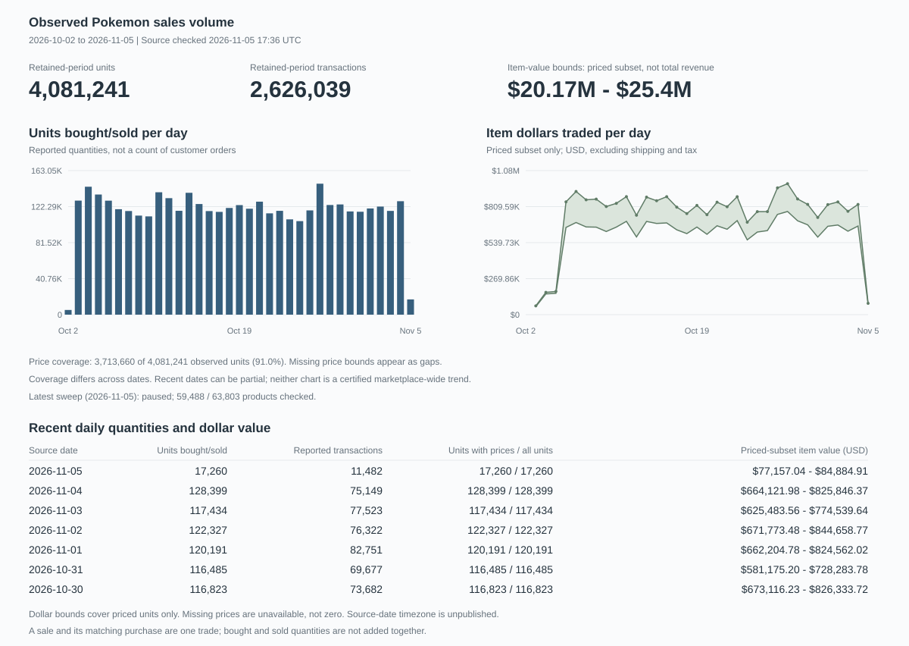

<div align="center">
  <h1>Pokemon Card Sales</h1>
  <p>
    <a href="#observed-sales-volume">Overview</a> ·
    <a href="#explore-the-data">Data</a> ·
    <a href="docs/methodology.md">Methodology</a> ·
    <a href="#setup">Setup</a>
  </p>
</div>

---

## Observed sales volume

Daily Pokemon card sales on TCGplayer: quantities sold, transaction counts,
item-dollar volume and Pokemon popularity, including singles and sealed products.
The catalog covers English and Japanese products; **sales coverage is still
partial, not a certified total for the whole marketplace**.

<p align="center">
  
</p>

The blue bars show reported units. The green band shows dollar bounds for
**only the units with actual sale prices**; it is not estimated total revenue.
Coverage varies by date, and recent dates may be incomplete.

The table below the charts lists **units bought/sold, transaction counts and
item-dollar value for each recent day**. The [complete daily trading CSV](reports/latest/daily-trading.csv)
puts these figures and price coverage together for every retained date.
A sale and its matching purchase are one trade, not two volumes; a sealed
product counts as one unit, not the number of cards inside.

Separately, the individual-sale archive retains actual timestamps, quantities
and unit prices for four products. Its captured dollar totals are exact for
those retained rows, but five-row public windows can miss intervening sales.
The two datasets are never added together.

## Explore the data

| Dataset | Reports | Complete downloads |
| --- | --- | --- |
| Daily sales volume | [Daily units, transactions and dollars together](reports/latest/daily-trading.csv), [price coverage and bounds](reports/latest/daily-sales-value.csv) | [All retained SKU-day buckets and the product catalog](https://github.com/hanshanley/pokemon-tcg/releases/tag/daily-volume) |
| Per product, daily | [Period totals](reports/latest/product-volume.csv); complete daily detail in the download | [Daily units, transactions and dollars per product (CSV.gz)](https://github.com/hanshanley/pokemon-tcg/releases/download/daily-volume/product-daily-trading.csv.gz) |
| Per Pokemon, daily | [Units, transactions and dollars](reports/latest/pokemon-sales-value.csv) | Included in the daily-volume release |
| Per set, daily | [Units, transactions and dollars](reports/latest/set-daily-trading.csv) | Included in the daily-volume release |
| Individual sales | [Every captured sale](reports/individual-sales/transactions.csv), [daily captured dollars](reports/individual-sales/daily-sales.csv) | [Complete CSV and public-only SQLite archive](https://github.com/hanshanley/pokemon-tcg/releases/tag/individual-sales) |
| Collection coverage | [Catalog sweep and price coverage](reports/latest/coverage.json), [individual-sale checks and gaps](reports/individual-sales/coverage.json) | Coverage files accompany both releases |

Downloads contain all matching retained records, not just rankings or metadata.
Empty or failed histories are unknown, not zero sales. Pokemon rankings include
singles only; a multi-Pokemon card can contribute to more than one species.

Definitions, source date conventions, deduplication, dollar calculations and
coverage limitations are in the [methodology](docs/methodology.md).
The [source assessment](docs/sources.md) documents alternatives to TCGplayer
and what would be needed to connect them.

## Automatic updates

[Daily volume collection](.github/workflows/daily-volume.yml) is scheduled at
**00:15 UTC** on GitHub-hosted runners, with resumable state and publication to
`main`. [Individual sales](.github/workflows/individual-sales.yml) are scheduled
every three hours. No Mac or personal computer needs to be on.

Reports, full downloads and the overview figure update from the retained data.
Source errors remain visible in coverage and workflow results; a partial sweep
is never labeled complete. GitHub may delay scheduled runs.
A separate [freshness check](.github/workflows/daily-data-check.yml) checks
publication and successful native-source observation timestamps.

## Setup

Requires Node.js 22.13 or newer.

```sh
npm ci
npm run catalog
npm start
```

Open `http://127.0.0.1:3000` for the local dashboard. It uses the local database,
not the remote release automatically. Collection, checkpoint restoration,
authorized transaction imports and SQL examples are documented in
[operations](docs/methodology.md#daily-github-updates).

```sh
npm run figures    # Regenerate the overview from the published CSVs
npm run check
npm test
```
