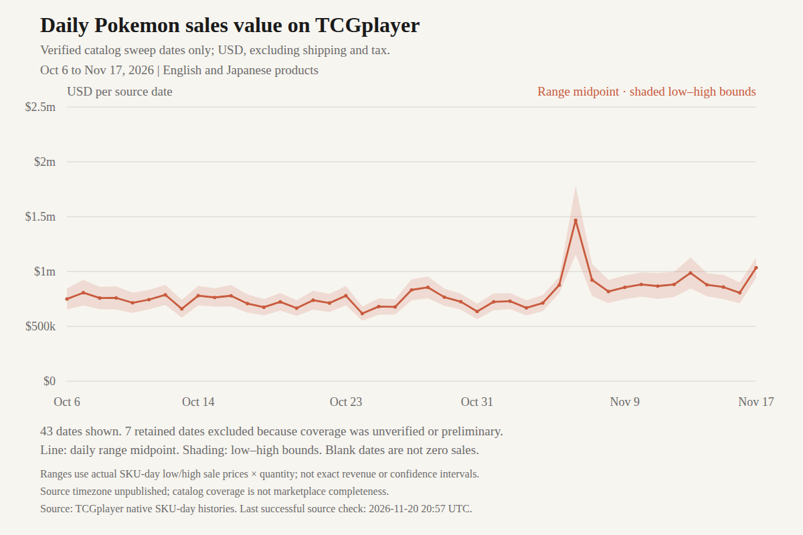

<div align="center">
  <h1>Pokemon Card Sales</h1>
  <p>
    <a href="#observed-sales-volume">Overview</a> ·
    <a href="#daily-pokemon-leaderboard">Leaderboard</a> ·
    <a href="#explore-the-data">Data</a> ·
    <a href="docs/methodology.md">Methodology</a> ·
    <a href="#setup">Setup</a>
  </p>
</div>

---

## Observed sales volume

Daily Pokemon card sales on TCGplayer: quantities sold, transaction counts,
item-dollar volume and Pokemon popularity, including singles and sealed products.
The catalog covers English and Japanese products; **sales coverage is still
partial, not a certified total for the whole marketplace**.

<p align="center">
  
</p>

The line joins daily range midpoints; shading shows item-value bounds from actual
low/high SKU sale prices, **not exact revenue or a confidence interval**. The
midpoint is a visual summary of the bounds, not a revenue estimate. Only closed dates with
verified catalog sweeps and complete price coverage are plotted. Missing and
partial days are left out, not treated as zero.

Download the [PNG](reports/latest/sales-value.png), [exact chart data](reports/latest/sales-value.csv),
or [caption, alt text and source hashes](reports/latest/sales-value.json).
The [quantity overview](reports/latest/volume.svg) includes a recent-day table.
The [complete daily trading CSV](reports/latest/daily-trading.csv) lists **units
bought/sold, transaction counts and item-dollar value** for every retained date.
A sale and its matching purchase are one trade, not two volumes; a sealed
product counts as one unit, not the number of cards inside.

### Historical archive

The chart's date range does not limit the archive. Every retained source date is
kept in SQLite, public checkpoints and the complete CSV downloads, including
older dates without verified sweep or price coverage. New rolling-window
collections update overlapping observations without dropping older ones;
historical backfills have no chart-date cutoff.

As audited on **November 19, 2026**, retained daily observations begin on
**October 2, 2026**; the main chart begins on **October 6**, when verified sweep
and complete price coverage first coincide. The connected collector reads the
source's rolling 30-day daily history; no unlimited historical feed is connected.
Earlier daily quantities
or dollars cannot be reconstructed from market-price charts or coarser buckets.
No earlier observations were found in the 86 published coverage snapshots audited.
The project keeps accumulating history rather than trimming the archive to 30 days.

Separately, the individual-sale archive retains actual timestamps, quantities
and unit prices for four products. Its captured dollar totals are exact for
those retained rows, but five-row public windows can miss intervening sales.
The two datasets are never added together.

## Daily Pokemon leaderboard

<!-- BEGIN POKEMON LEADERBOARD -->

**2026-11-17** (TCGplayer source date; verified catalog sweep) · ranked by reported units sold.

| Rank | Pokemon | Units sold | Reported transactions |
| ---: | --- | ---: | ---: |
| 1 | Pikachu | 5,758 | 3,548 |
| 2 | Eevee | 1,287 | 716 |
| 3 | Mewtwo | 1,128 | 664 |
| 4 | Mew | 1,106 | 538 |
| 5 | Gengar | 961 | 537 |
| 6 | Meowth | 921 | 658 |
| 7 | Charizard | 768 | 559 |
| 8 | Umbreon | 683 | 366 |
| 9 | Greninja | 651 | 398 |
| 10 | Venusaur | 621 | 178 |

<!-- END POKEMON LEADERBOARD -->

Updates with the daily sales reports, using the latest date backed by a verified
catalog sweep. Counts can still be revised and are not marketplace totals.
Tag-team cards count toward each tagged Pokemon, so rows are not additive.
[Download all Pokemon and dates](reports/latest/pokemon-daily.csv).

## Daily eBay sample

The [daily eBay listing counts](reports/ebay-sample/daily.csv) track the
rotating Jsonify sample, not the entire market. The scheduled job preserves
[every retained observation](reports/ebay-sample/observations.csv) and
[all distinct listing/date pairs](reports/ebay-sample/listings.csv).
See the [capture date and coverage](reports/ebay-sample/coverage.json).
If the newest capture is more than 30 hours old, the job fails instead of
republishing the archive as fresh.
Listing counts are not card quantities or transactions; displayed prices
can include asking prices for undisclosed offers. This sample is never merged
with TCGplayer.

Data: [Jsonify](https://www.jsonify.com/datasets/ebay-us-pok-mon-sold-listings-9c1de2dcf5cc),
[CC BY 4.0](https://creativecommons.org/licenses/by/4.0/). We omit images
and listing titles and count repeated listing/date pairs once.

## Explore the data

| Dataset | Reports | Complete downloads |
| --- | --- | --- |
| Daily sales volume | [Daily units, transactions and dollars together](reports/latest/daily-trading.csv), [price coverage and bounds](reports/latest/daily-sales-value.csv) | [All retained SKU-day buckets and the product catalog](https://github.com/hanshanley/pokemon-tcg/releases/tag/daily-volume) |
| Per product, daily | [Period totals](reports/latest/product-volume.csv); complete daily detail in the download | [Daily units, transactions and dollars per product (CSV.gz)](https://github.com/hanshanley/pokemon-tcg/releases/download/daily-volume/product-daily-trading.csv.gz) |
| Per Pokemon, daily | [Units, transactions and dollars](reports/latest/pokemon-sales-value.csv) | Included in the daily-volume release |
| Per set, daily | [Units, transactions and dollars](reports/latest/set-daily-trading.csv) | Included in the daily-volume release |
| Individual sales | [Every captured sale](reports/individual-sales/transactions.csv), [daily captured dollars](reports/individual-sales/daily-sales.csv) | [Complete CSV and public-only SQLite archive](https://github.com/hanshanley/pokemon-tcg/releases/tag/individual-sales) |
| Collection coverage | [Catalog sweep and price coverage](reports/latest/coverage.json), [individual-sale checks and gaps](reports/individual-sales/coverage.json) | Coverage files accompany both releases |

Downloads contain all matching retained records, not just rankings or metadata.
Empty or failed histories are unknown, not zero sales. Pokemon rankings include
singles only; a multi-Pokemon card can contribute to more than one species.

Definitions, source date conventions, deduplication, dollar calculations and
coverage limitations are in the [methodology](docs/methodology.md).
The [source assessment](docs/sources.md) documents alternatives to TCGplayer
and what would be needed to connect them.

## Automatic updates

**Daily TCGplayer volume collection is paused.** TCGplayer denied access
to the daily history source; the chart and leaderboard still show verified
historical dates. A complete, authorized export can be
[retrieved automatically or imported offline](docs/methodology.md#offline-daily-history-recovery).

When approved source access is available, the [daily volume workflow](.github/workflows/daily-volume.yml) runs at
**00:15 UTC**, with catch-up checks at **06:15, 12:15 and 18:15 UTC**, on
GitHub-hosted runners. An incomplete sweep resumes its saved queue; a complete
sweep is skipped only if the source catalog build is unchanged.
Publication goes to `main`. [Individual sales](.github/workflows/individual-sales.yml) are scheduled
every three hours. No Mac or personal computer needs to be on.

Reports, full downloads and the embedded PNG update from the retained data
on every daily-volume publication.
Source errors remain visible in coverage and workflow results; a partial sweep
is never labeled complete. GitHub may delay scheduled runs.
A separate [daily check](.github/workflows/daily-data-check.yml) requires fresh
publication, fresh native-source observations and a complete current-day sweep.

## Setup

Requires Node.js 22.13 or newer.

```sh
npm ci
npm run catalog
npm start
```

Open `http://127.0.0.1:3000` for the local dashboard. It uses the local database,
not the remote release automatically. Collection, checkpoint restoration,
authorized transaction imports and SQL examples are documented in
[operations](docs/methodology.md#daily-github-updates).

Look up an exact Pokemon using the autocomplete, or find a card by name, set,
card number or TCGplayer product ID and choose **View sales**. The selection
filters summaries, daily history, actual sale-price bounds and complete sales
downloads. Clear the lookup to return to the full dataset.
The Pokemon leaderboard supports any retained date range, a **Show this day**
shortcut, and ranking by units sold or transactions. Click a Pokemon to explore
its cards. Native history is daily, not intraday; unavailable history is not zero.

```sh
npm run figures    # Regenerate the overview from the published CSVs
npm run check
npm test
```
